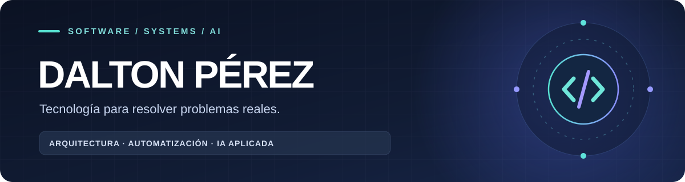

  

  <strong>Desarrollo soluciones digitales para desafíos del mundo real.</strong> 
  Enterprise Software · System Architecture · Automation · Applied AI

  <a href="https://github.com/DaltonP93">GitHub</a> ·
  <a href="https://www.linkedin.com/in/dalton-perez-12067189/">LinkedIn</a>

---

### 👋 Sobre mí

Soy **Dalton Pérez**. Me apasiona convertir procesos complejos en sistemas claros, útiles y sostenibles: desde entender las necesidades de una organización hasta diseñar, desarrollar, integrar y operar la solución.

Mi trabajo conecta **software empresarial, infraestructura, automatización e inteligencia artificial**. Me interesan especialmente los proyectos en los que la tecnología mejora la atención a las personas, simplifica el trabajo diario y permite que una organización crezca sin perder el control de sus operaciones.

> **Mi enfoque:** construir software que no solo funcione en una demostración, sino que también sea seguro, mantenible y confiable en su operación.

### 🧩 Áreas en las que construyo

| Área | Problemas que busco resolver |
| :--- | :--- |
| 🏥 **Salud y servicios** | Portales, turnos, atención al paciente y digitalización de procesos. |
| 👥 **Personas y operaciones** | Asistencia, recursos humanos, calendarios laborales y gestión administrativa. |
| 🖥️ **Infraestructura y seguridad** | Monitoreo, videovigilancia, integraciones de TI y continuidad operativa. |
| 🔄 **Experiencia de atención** | Flujos de servicio, gestión de colas, citas y plataformas modulares. |
| 🤖 **IA para ingeniería** | Agentes, automatización del desarrollo, análisis de código y herramientas de productividad. |

Parte de este trabajo se desarrolla en repositorios privados; comparto aquí una descripción general de las áreas, no detalles internos de implementación.

### 🛠️ Tecnologías y herramientas

**Desarrollo y arquitectura**

**Datos, operaciones y calidad**

**También trabajo con:** APIs e integraciones, Linux, redes, CI/CD, seguridad de aplicaciones, observabilidad, agentes de IA y MCP.

### 🧭 Cómo me gusta trabajar

- **Entender antes de desarrollar:** conocer el proceso y las necesidades de quienes usarán el sistema.
- **Construir por etapas:** arquitectura modular, cambios revisables y evolución progresiva.
- **Verificar con evidencia:** pruebas automatizadas, CI y validación de integraciones.
- **Diseñar para la operación:** seguridad, respaldos, recuperación, monitoreo y mantenimiento.
- **Aplicar IA con criterio:** aprovechar agentes y automatizaciones, conservando la revisión humana y el control técnico.

### 🚀 Lo que más me interesa hoy

`SaaS modular` · `Arquitecturas multi-tenant` · `Agentes de IA` · `Automatización empresarial` · `DevSecOps` · `Integración de sistemas`

### 🤝 Conectemos

Disfruto explorar herramientas, compartir ideas y aprender de quienes construyen tecnología útil.

---

Construir bien también significa pensar en las personas que usarán y mantendrán el sistema.

